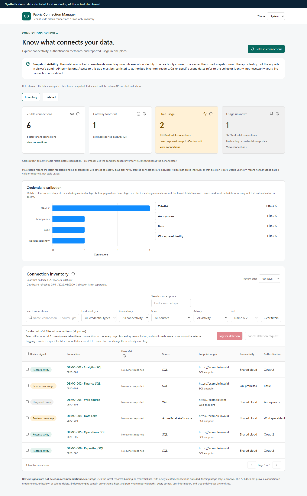

# Fabric Connection Manager

This demo collects tenant-wide connection metadata and role assignments using
the Microsoft Fabric admin APIs. A Fabric App displays the collected inventory
and records deletion requests and cancellations.

- [Setup](SETUP.md): create resources, configure, deploy and verify.
- [Collector guide](fabric/Readme.md): run the notebook and check its output.
- [App guide](app/README.md): dashboard behavior and deletion requests.

## Status

| Field | Value |
| --- | --- |
| Demo status | Validated |
| Last updated | 2026-11-05 |
| Product maturity | Admin connections APIs and Fabric Apps/Rayfin: Preview |

This is a demo, not a production-ready service.

## What this demonstrates

```http
GET https://api.fabric.microsoft.com/v1/admin/connections
GET https://api.fabric.microsoft.com/v1/admin/connections/{connectionId}/roleAssignments
```

The dashboard lets you search connections, see their owners and credential
types, and review reported usage across the tenant. It shows when the data was
collected. It does not retrieve credentials or connect to the underlying sources.

The walkthrough covers collecting the inventory, inspecting a connection, marking it
for deletion review, and cancelling the request.

Missing usage is **unknown**, not proof that a connection is unused or safe to
delete. Owners are current assignments, not necessarily the original creators.

## Dashboard

The dashboard combines usage summaries, credential types, filters and the
connection inventory. This is a local rendering of the app with synthetic data,
not a screenshot of a live tenant.



## Architecture

```text
Fabric admin APIs
      |
      | paginated, paced collection in a notebook
      v
Lakehouse: immutable inventory runs and access assignments
      |
      | SQL analytics endpoint / read-only connector
      v
Fabric App: search, filter, inspect, and review

Deletion-request workflow:
Fabric App -> authenticated Functions -> SQL Database action log
```

The notebook collects the data separately from the app. Refreshing the dashboard
reads the latest completed collection; it does not call the admin APIs again.
Everyone using the app reads the same collected inventory.

The app loads the selected snapshot before client-side filtering and paging.
It validates counts and relationships before displaying inventory.

Marking a connection records a deletion request in the SQL Database. Cancelling
it records the cancellation. Neither action deletes the connection. The current
UI needs the SQL Database and Functions configured, even if you only view inventory.

The action store is a standalone Fabric SQL Database, not the app-managed child
database. This example manages its SQL procedures explicitly and keeps the store
available to separately authorized tools. It adds a resource to configure; it is
not a requirement for every Fabric App.

## Reusing this example

Start with the included setup rather than creating another Rayfin starter.
The [collector](fabric/collect_connection_inventory.py) and
[inventory schema](fabric/inventory_schema.sql) can also be used without the app.

For app changes, the [app guide](app/README.md) is the starting point. Keep the
read-only inventory connector separate from the action store, and keep caller
verification and server-side request validation. This is a reference example,
not a general-purpose template or a complete connection-management service.

## Outside demo scope: possible deletion workflow

Actual deletion is not part of this demo; no deletion script is included.
In a separate implementation, a worker could pick up approved requests, check
that the connection has not changed and the request has not been cancelled, then
call the documented preview
[Admin Delete Connection API](https://learn.microsoft.com/en-us/rest/api/fabric/admin/connections/delete-connection).
It would then check the result and record what happened. That would need
separate permissions, error handling and testing.
Delegated calls require Fabric administrator authorization and
`Tenant.ReadWrite.All`; service principals and managed identities are also supported.

## Access and data safety

The notebook calls the APIs as its execution identity. The app reads the stored
data using application authentication, not each viewer's Fabric API permissions.
Giving someone access to the app can therefore expose tenant-wide metadata they
could not otherwise read. Restrict both the app and its data sources to authorized
administrators. Stored data can also outlive changes to source permissions.

For user API calls, Fabric requires administrator authorization and
`Tenant.Read.All` or `Tenant.ReadWrite.All`. Service principals and managed
identities are also supported, subject to tenant settings.

Use synthetic data in public screenshots. Never publish notebook outputs,
credentials, connection paths, local environment files or deployment state.

## Prerequisites

- A Fabric tenant and capacity-backed workspace with Fabric Apps/Rayfin enabled
  in a supported region, and permission to create the required items.
- A schema-enabled Lakehouse, notebook/Spark access, and its SQL analytics
  endpoint.
- An identity authorized for the admin inventory APIs and Lakehouse writes.
- Read permission for the app's inventory connector identity.
- For the included action workflow: a Fabric SQL Database, supported Functions
  access, and the app-owner identity's required SQL procedure permissions.
- Node.js **22.15 or newer**, compatible with the pinned tools, and npm.
- Approved access to the Microsoft Fabric/Rayfin preview npm packages.

## Limits and cleanup

Collection is manual; run one collector at a time. See the
[collector guide](fabric/Readme.md) for pacing, limits and failure handling.

To clean up, remove the app, notebook, Lakehouse and SQL Database you created.
First check that nothing else uses them and keep any audit history you need.
There is no cleanup script.

## References

- [Admin List Connections](https://learn.microsoft.com/en-us/rest/api/fabric/admin/connections/list-connections)
- [Admin List Connection Role Assignments](https://learn.microsoft.com/en-us/rest/api/fabric/admin/connections/list-connection-role-assignments)
- [Admin Delete Connection](https://learn.microsoft.com/en-us/rest/api/fabric/admin/connections/delete-connection)
- [Tenant-wide connection management](https://learn.microsoft.com/en-us/fabric/data-factory/data-source-management#manage-connections-tenant-wide-with-the-admin-apis)
- [Fabric Apps](https://learn.microsoft.com/en-us/fabric/apps/overview)
- [Create a Fabric App with the CLI](https://learn.microsoft.com/en-us/fabric/apps/create-app-with-cli)
- [Alternative delegated-browser design](https://github.com/nabhishek/fabric-connection-inventory)

The application retains the Microsoft starter's [MIT license](app/LICENSE).
